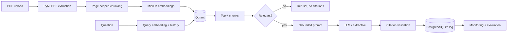

# SourceIQ — Enterprise AI Knowledge Intelligence Platform

A production-shaped RAG assistant for internal documents: upload policy PDFs, ask
questions in natural language, and get answers **grounded in retrieved passages
with document + page citations**, conversation memory, monitoring and a
reproducible retrieval evaluation suite.

Built to demonstrate Generative AI / LLM / RAG / vector-database / AI-application
engineering — not just a notebook demo.

```
PDF upload → text extraction (PyMuPDF) → page-scoped chunking → MiniLM embeddings
   → Qdrant → question embedding → top-k retrieval → relevance gate
   → grounded prompt → LLM (or extractive fallback) → citation validation
   → answer + sources → PostgreSQL/SQLite history → monitoring + evaluation
```

## Why this is not a PDF chatbot

- **Real ingestion lifecycle** — `pending → processing → completed/failed`, with
  retries, content-hash de-duplication and vector cleanup on delete.
- **Citations are validated server-side.** The model emits `[n]`; the API maps it
  back to a retrieved chunk and strips markers that point at documents that were
  never retrieved.
- **It refuses when it should.** If the best cosine score is below the threshold,
  the answer is a fixed refusal with zero citations — not a confident guess.
- **Retrieval is evaluated, not assumed.** A fixed 12-question set measures hit
  rate, MRR, context precision, citation accuracy, faithfulness and answer
  relevance on every change.
- **Runs without an API key.** A deterministic extractive answerer keeps the demo
  and CI fully offline; plug in any OpenAI-compatible endpoint for fluent answers.
- **Observability built in.** Per-stage latency, token usage, fallback rate, top
  retrieval score and recent query logs are exposed as JSON and in the UI.

## Features (8/8)

| # | Feature | Implementation |
| --- | --- | --- |
| 1 | Document management | PDF upload, multi-file, list, metadata, delete, status machine (`api/main.py`, `documents/service.py`) |
| 2 | Processing & chunking | PyMuPDF extraction, cleaning, sentence-aware overlapping chunks, page numbers preserved (`documents/extract.py`, `chunking.py`) |
| 3 | Embeddings | Sentence Transformers (`all-MiniLM-L6-v2`) with a deterministic hashing fallback (`embeddings/`) |
| 4 | Vector database | Qdrant collection, upsert, top-k cosine search, document filters, bulk delete (`vectorstore/qdrant_store.py`) |
| 5 | RAG answering | Query embedding → retrieval → numbered context → grounded generation (`rag/`) |
| 6 | Citations & hallucination control | Relevance gate, citation-first prompt, marker validation, refusal path (`rag/citations.py`, `llm/prompts.py`) |
| 7 | Conversation history | Conversation + message tables, follow-up query expansion, transcript endpoints, delete (`db/`, `rag/service.py`) |
| 8 | FastAPI, evaluation & monitoring | REST API, query log, latency/token metrics, evaluation dataset + runner (`api/`, `evaluation/`) |

Bonus: Docker + Compose (Qdrant + PostgreSQL + API + Next.js), GitHub Actions CI,
65 backend tests.

## Evaluation results

12 questions over 5 policy PDFs · 23 page-level chunks · top-k = 5 ·
`all-MiniLM-L6-v2` · extractive answerer (no API key):

| Metric | Score |
| --- | --- |
| Retrieval hit rate | **1.000** |
| MRR | **0.958** |
| Context precision | 0.200 |
| Answer keyword coverage | **0.917** |
| Citation accuracy | **0.917** |
| Faithfulness | **1.000** |
| Answer relevance | 0.735 |
| Fallback rate | 0.000 |
| Average retrieval latency | **~9 ms** |

Context precision of 0.20 is expected: one gold page among five retrieved.
Reproduce with `python scripts/evaluate.py`; methodology and limitations are in
[docs/rag-evaluation.md](docs/rag-evaluation.md).

## Quickstart

### 1. Backend

```bash
python -m venv .venv
# Windows: .venv\Scripts\activate
source .venv/bin/activate

pip install -r requirements.txt
pip install -e .
```

Optional but recommended for semantic embeddings (downloads torch CPU, ~200 MB):

```bash
pip install -r requirements-embeddings.txt
```

Without it the API automatically uses the deterministic hashing embedder.

### 2. Documents and index

```bash
python scripts/make_sample_documents.py        # generate 5 sample policy PDFs
python scripts/seed_documents.py               # extract, embed, index
```

Or bring your own PDFs: drop them into `data/sample_documents/` (or upload through
the UI/API after starting the server) and run `seed_documents.py` again.

### 3. API

```bash
uvicorn sourceiq.api.main:app --reload
# http://localhost:8000/docs
```

### 4. Frontend

```bash
cd frontend
npm install
cp .env.local.example .env.local
npm run dev            # http://localhost:3000
```

### 5. Optional: real LLM answers

The demo works offline with the extractive answerer. For fluent generation, set
an OpenAI-compatible key in `.env`:

```bash
SOURCEIQ_LLM_PROVIDER=auto
SOURCEIQ_LLM_API_KEY=sk-...
SOURCEIQ_LLM_MODEL=gpt-4o-mini
# SOURCEIQ_LLM_BASE_URL=https://api.openai.com/v1   # or any compatible gateway
```

Restart the API; `/health` shows the active provider and model.

## Example

```bash
curl -X POST http://localhost:8000/chat \
  -H "Content-Type: application/json" \
  -d '{"question": "How many days per week can I work remotely?"}'
```

```json
{
  "answer": "Based on the retrieved documents:\n- Remote-eligible employees may work remotely for two days per week. [1]",
  "citations": [
    {
      "index": 1,
      "filename": "Remote_Work_Policy.pdf",
      "page": 2,
      "score": 0.6712,
      "snippet": "2. Hybrid schedule and approval. Remote-eligible employees may work remotely for two days per week…"
    }
  ],
  "grounded": true,
  "fallback": false,
  "provider": "extractive",
  "retrieval_latency_ms": 12.4,
  "total_latency_ms": 13.0
}
```

Full reference: [docs/api.md](docs/api.md).

## API surface

| Method | Path | Purpose |
| --- | --- | --- |
| POST | `/documents/upload` | Upload and index a PDF (202 + background task) |
| GET | `/documents` | List with processing status |
| GET | `/documents/{id}` | Poll a single document |
| POST | `/documents/{id}/process` | Retry / re-index synchronously |
| DELETE | `/documents/{id}` | Remove file, vectors and metadata |
| POST | `/chat` | Grounded answer + citations + history |
| GET | `/conversations` · `/conversations/{id}` | Conversation list / transcript |
| DELETE | `/conversations/{id}` | Clear a conversation |
| GET | `/monitoring/summary` · `/monitoring/queries` | Volume, latency, tokens, fallbacks, query log |
| GET | `/evaluation/latest` · POST `/evaluation/run` | Retrieval evaluation report / run |
| GET | `/health` | Per-component health |

## Architecture



Details and trade-offs: [docs/architecture.md](docs/architecture.md).

## Project structure

```
src/sourceiq/
├── config.py            # env-driven settings
├── services.py          # shared service container
├── db/                  # SQLAlchemy models + repository + monitoring aggregates
├── documents/           # extraction, chunking, storage, lifecycle
├── embeddings/          # sentence-transformers + hashing fallback
├── vectorstore/         # Qdrant client wrapper
├── llm/                 # prompts, OpenAI-compatible client, extractive answerer
├── rag/                 # retriever, generator, citations, orchestration
├── evaluation/          # metrics + dataset runner
└── api/                 # FastAPI app and schemas
frontend/                # Next.js 14 + Tailwind UI
scripts/                 # sample docs, seed, evaluate, simulate, reset
tests/                   # 65 tests, fully offline
docs/                    # architecture, API, evaluation, interview notes
```

## Testing & CI

```bash
pip install -r requirements-dev.txt
pytest -q          # 65 tests, no network, no API key
ruff check src tests scripts
```

Tests cover PDF extraction and cleaning, chunk overlap and page preservation,
embedding normalisation, Qdrant upsert/filter/delete, the full document
lifecycle, citation validation, LLM failure fallback, retrieval metrics, the
end-to-end evaluation runner and every API endpoint.

CI (`.github/workflows/ci.yml`) runs lint, backend tests, a hashing-embedder smoke
run of ingestion + evaluation, and a production build of the Next.js app.

## Docker

```bash
docker compose up --build
# Frontend  → http://localhost:3000
# API       → http://localhost:8000/docs
# Qdrant    → http://localhost:6333/dashboard
```

Compose starts Qdrant, PostgreSQL, the API and the frontend. The API image bakes
the embedding model so containers start offline; the entrypoint generates and
indexes the sample corpus on first boot. Mount your own PDFs into
`data/sample_documents/` and re-run `python scripts/seed_documents.py`, or upload
through the UI.

## Technology

| Technology | Role |
| --- | --- |
| Python 3.10+ | Core |
| FastAPI + Pydantic v2 | REST API and validation |
| Sentence Transformers (MiniLM) | Embeddings |
| Qdrant | Vector database |
| PyMuPDF | PDF extraction with page provenance |
| OpenAI-compatible LLM | Answer generation (optional) |
| PostgreSQL / SQLite + SQLAlchemy | Conversations, documents, query logs |
| Next.js 14 + Tailwind | Frontend |
| Docker + Compose, GitHub Actions | Packaging and CI |


