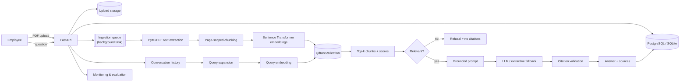

# Architecture



## Request lifecycle

### Ingestion

```
POST /documents/upload
  -> validate PDF (%PDF header, type, size, SHA-256)
  -> store file as data/uploads/<uuid>.pdf
  -> insert document row (status=pending)
  -> 202 + background task
       -> status=processing
       -> PyMuPDF page-wise extraction + cleaning
       -> chunk (page scoped, sentence aware, overlapping)
       -> embed in batches
       -> delete old vectors for this document
       -> upsert points into Qdrant
       -> status=completed (page_count, chunk_count)
       -> any failure -> status=failed + error message
```

The status machine is explicit (`pending -> processing -> completed|failed`) and
the dashboard polls `GET /documents`, so users see progress instead of a spinner
that never ends.

### Question answering

```
POST /chat {question, conversation_id?, top_k?, document_ids?}
  -> load or create conversation
  -> load recent turns (bounded by SOURCEIQ_MAX_HISTORY_MESSAGES)
  -> optionally expand follow-up questions with the previous user turn
  -> embed question, Qdrant top-k cosine search (optional document filter)
  -> relevance gate: if top score < min_relevance_score -> refusal
  -> build numbered context blocks (document, page, score)
  -> LLM with a citation-first system prompt + history
  -> validate [n] markers against the retrieved set, drop invented markers
  -> persist user + assistant messages, log the query with latencies/tokens
  -> return answer, citations, sources, grounded/fallback flags
```

## Module map

| Path | Responsibility |
| --- | --- |
| `src/sourceiq/config.py` | Env-driven settings, paths, chunk/retrieval/LLM knobs |
| `src/sourceiq/db/models.py` | Documents, conversations, messages, query logs |
| `src/sourceiq/db/repository.py` | Sessions, CRUD, monitoring aggregates |
| `src/sourceiq/documents/extract.py` | PyMuPDF extraction, cleaning, page provenance |
| `src/sourceiq/documents/chunking.py` | Sentence-aware, page-scoped overlapping chunks |
| `src/sourceiq/documents/service.py` | Upload validation, lifecycle, dedup, deletion |
| `src/sourceiq/embeddings/` | Sentence Transformer + deterministic hashing fallback |
| `src/sourceiq/vectorstore/qdrant_store.py` | Collection management, upsert, filtered search |
| `src/sourceiq/llm/` | Prompts, OpenAI-compatible client, extractive answerer |
| `src/sourceiq/rag/` | Retriever, generator, citation validation, orchestration |
| `src/sourceiq/evaluation/` | Metrics, dataset loader, end-to-end runner |
| `src/sourceiq/api/` | FastAPI routes, schemas, graceful degradation |
| `src/sourceiq/services.py` | Shared service container for API, scripts, tests |
| `frontend/` | Next.js chat + document UI |

## Key design decisions

1. **Page-scoped chunks.** A chunk never spans a page, so a citation can always
   name a single page. Cross-page context is recovered by retrieving several
   chunks, not by blurring provenance.
2. **Overlap with sentence boundaries.** Windows are cut at the last sentence
   boundary and the next window starts on a word boundary. Overlap preserves
   definitions that straddle a cut without producing half words.
3. **Retrieval is gated.** If the best cosine score is below the configured
   threshold the assistant refuses instead of asking the LLM to "do its best".
   This is the single most effective hallucination control.
4. **Citations are validated server-side.** The model emits `[n]`; the server
   maps markers back to retrieved chunks and removes markers that point outside
   the retrieved set. A model cannot cite a document that was never retrieved.
5. **Preprocessing is in the serving path.** Chunking and embedding live in the
   application (not in a notebook), so the API indexes exactly what it retrieves.
6. **Two embedding backends behind one interface.** Sentence Transformers for
   quality, a deterministic hashing vectoriser for CI and air-gapped demos.
   `/health` always reports which one is active.
7. **Two LLM strategies.** An OpenAI-compatible client for fluent answers and an
   extractive answerer that copies sentences from the retrieved context. The
   extractive mode makes the whole demo runnable without an API key, and acts as
   a safety net if the provider fails.
8. **Streaming-free simplicity.** Answers are returned in one response with
   token usage and per-stage latency. Streaming is a documented extension, not a
   hidden requirement.

## Failure modes

| Failure | Behaviour |
| --- | --- |
| Scanned PDF / no text layer | Document marked `failed` with an OCR hint, no vectors written |
| Duplicate upload (same SHA-256) | Existing completed document returned, no re-index |
| LLM API down | Retries once through the extractive answerer, response flagged with `llm_fallback_used` |
| No relevant context | Refusal answer, `fallback=true`, zero citations |
| Invalid citation marker | Marker stripped, answer flagged, only retrieved sources returned |
| Qdrant unavailable | `/health` reports `degraded`; uploads fail with an actionable error |
| Embedding model switched | Startup fails fast with the collection/embedding dimension mismatch |
| Very long conversation | History is truncated to `SOURCEIQ_MAX_HISTORY_MESSAGES` before prompting |

## Where it can grow

- Hybrid retrieval (BM25 + dense) for numeric identifiers and rare acronyms.
- Reranking with a cross-encoder before generation.
- Streaming answers over SSE and cancellation.
- LLM-as-judge evaluation with human-reviewed calibration.
- Per-document ACLs and audit exports.
